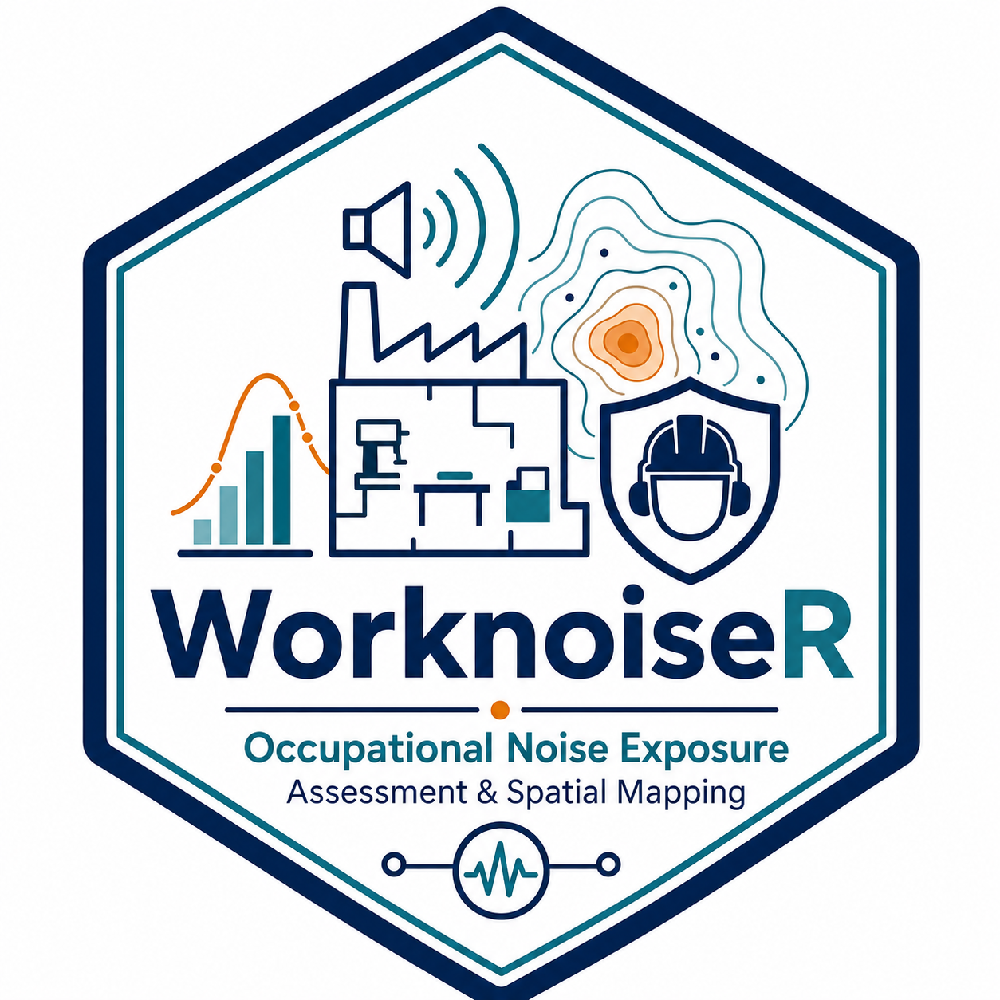

<p align="center">
  
</p>

# WorknoiseR

**Occupational Noise Exposure Assessment and Spatial Mapping**

[](https://github.com/Aguilar-Elena/WorknoiseR/actions/workflows/R-CMD-check.yaml)
[](LICENSE)

**WorknoiseR** is a bilingual R package and Shiny application for occupational noise exposure assessment, hearing-protector evaluation, regulatory interpretation and spatial noise mapping.

It is designed for occupational hygienists, occupational safety and health practitioners, prevention technicians, researchers and engineers who need to calculate occupational noise exposure, evaluate hearing protection, interpret results against applicable action and limit values, and model the spatial distribution of sound levels in workplaces.

Unlike a closed calculator, WorknoiseR exposes the underlying calculations as reusable R functions. This makes assessments reproducible, auditable and suitable for automation, while the optional Shiny application provides a guided workflow for practitioners who prefer not to write code.

## Why WorknoiseR?

Occupational noise assessment involves several tasks that are often handled with separate spreadsheets, calculators or specialist applications:

- logarithmic addition of sound levels;
- daily and weekly occupational exposure;
- noise dose and maximum admissible exposure time;
- hearing-protector assessment;
- regulatory interpretation;
- propagation from one or more sources;
- receiver calculations;
- barriers and reverberation;
- noise grids, contours and 2D/3D visualisation;
- import of worker exposure data;
- inverse estimation of source levels.

WorknoiseR brings these tasks together in a single reproducible workflow.

It helps answer questions such as:

- What is the daily noise exposure level for a worker performing several tasks?
- What is the weekly exposure when daily exposure varies?
- Has a lower or upper exposure action value been reached?
- Is the exposure limit value exceeded?
- What protected level is obtained using APV, HML or SNR?
- How does sound level decay with distance?
- What level is expected at a specific receiver?
- How do several sources combine energetically?
- How do barriers and approximate reverberation affect the predicted field?
- What do the noise contours look like inside an irregular workplace boundary?
- Can source levels be estimated from field measurements?

## Regulatory framework

WorknoiseR separates the calculation core from the regulatory presentation layer.

- **Spanish interface:** occupational noise assessment is presented with reference to **Real Decreto 286/2006**.
- **English interface:** occupational noise assessment is presented with reference to **Directive 2003/10/EC**, using European terminology such as `L_EX,8h` and `L_EX,w`.

The numerical core is shared by both languages. Changing the language changes labels, messages and regulatory terminology, not the acoustic calculations.

## What does WorknoiseR do?

WorknoiseR provides four main groups of functionality.

### 1. Occupational exposure

Daily and weekly exposure calculations, energetic addition, noise dose, maximum admissible exposure time and regulatory interpretation.

### 2. Hearing protection

Assessment using the APV, HML and SNR approaches.

### 3. Spatial noise modelling

Free-field propagation, multiple-source summation, point receivers, barriers, approximate reverberation, noise grids, contours and inverse source-level estimation.

### 4. Data import and interactive use

Flexible CSV import and a bilingual Shiny application integrating calculations, worker campaigns and 2D/3D noise mapping.

## Main functions

| Function | Area | What it does |
|---|---|---|
| `db_add()` | Exposure | Logarithmic addition of sound levels |
| `laeq_d()` | Exposure | Daily occupational noise exposure |
| `laeq_d_multi()` | Exposure | Daily exposure from multiple tasks or exposure periods |
| `laeq_s()` | Exposure | Weekly occupational noise exposure |
| `laeq_weekly()` | Exposure | Weekly exposure helper |
| `frequency_weighting()` | Exposure | Frequency-weighting correction |
| `noise_dose()` | Exposure | Noise dose calculation |
| `max_exposure_time()` | Exposure | Maximum admissible exposure time |
| `evaluate_rd286()` | Regulation | Spain-specific assessment under RD 286/2006 |
| `evaluate_noise_compliance()` | Regulation | Language-aware regulatory assessment |
| `apv_protection()` | Protection | Hearing-protector assessment using APV values |
| `hml_protection()` | Protection | Hearing-protector assessment using HML |
| `snr_protection()` | Protection | Hearing-protector assessment using SNR |
| `level_at_distance_free_field()` | Spatial | Free-field level at a given distance |
| `distance_for_level_free_field()` | Spatial | Distance corresponding to a target level |
| `receiver_level()` | Spatial | Predicted level at a point receiver |
| `noise_grid()` | Spatial | Spatial noise grid |
| `noise_contours()` | Spatial | Noise contour extraction |
| `estimate_source_levels()` | Spatial | Inverse estimation of source levels |
| `read_noise_csv()` | Import | Flexible occupational-noise CSV import |
| `set_worknoiser_language()` | Language | Sets the active language |
| `worknoiser_language()` | Language | Returns the active language |
| `run_noise_app()` | Shiny | Launches the interactive application |

## Installation

### Development version from GitHub

```r
# install.packages("remotes")
remotes::install_github("Aguilar-Elena/WorknoiseR")
```

Then load the package:

```r
library(WorknoiseR)
```

### From a source archive

```r
install.packages(
  "WorknoiseR_0.5.0.tar.gz",
  repos = NULL,
  type = "source"
)
```

## Language

WorknoiseR is bilingual in **Spanish** and **English**.

```r
library(WorknoiseR)

set_worknoiser_language("es")
worknoiser_language()

set_worknoiser_language("en")
worknoiser_language()
```

The Shiny application also includes an in-app **Idioma / Language** selector.

## Minimal usage

### Logarithmic addition

```r
db_add(c(80, 80))
```

### Daily exposure

```r
laeq_d(85, 8)
```

### Daily exposure from multiple tasks

```r
laeq_d_multi(
  levels = c(90, 85, 80),
  hours  = c(2, 3, 1)
)
```

### Weekly exposure

```r
laeq_s(c(80, 82, 84, 86, 88))
```

### Noise dose

```r
noise_dose(85, 4)
```

### Maximum admissible exposure time

```r
max_exposure_time(88)
```

## Regulatory assessment

### Spain — Real Decreto 286/2006

```r
set_worknoiser_language("es")

evaluate_noise_compliance(
  laeq_d = 85,
  lcpeak = 137,
  language = "es"
)
```

### European framework — Directive 2003/10/EC

```r
set_worknoiser_language("en")

evaluate_noise_compliance(
  laeq_d = 85,
  lcpeak = 137,
  language = "en"
)
```

The English output uses European terminology such as `L_EX,8h`, action values and exposure limit values under Directive 2003/10/EC.

## Hearing protection

### SNR

```r
snr_protection(
  lceq_t = 100,
  snr = 25
)
```

### HML

```r
hml_protection(
  laeq_t = 95,
  lceq_t = 100,
  H = 30,
  M = 25,
  L = 20
)
```

### APV

```r
apv_protection(
  levels_a = c(90, 92, 95, 96, 94, 91, 88),
  frequencies = c("125", "250", "500", "1000", "2000", "4000", "8000"),
  mf = c(20, 22, 24, 26, 28, 30, 32),
  sf = rep(3, 7)
)
```

## Spatial modelling

### Free-field propagation

```r
level_at_distance_free_field(
  level_1m = 100,
  distance_m = 10
)
```

### Point receiver

```r
sources <- data.frame(
  x = 0,
  y = 0,
  level = 100
)

receiver_level(
  x = 10,
  y = 0,
  sources = sources
)
```

### Noise grid

```r
grid <- noise_grid(
  sources = sources,
  domain = c(0, 20, 0, 20),
  resolution = 2
)
```

### Noise contours

```r
noise_contours(
  grid,
  breaks = c(75, 80, 85, 90)
)
```

## Interactive application

Launch the Shiny application with:

```r
run_noise_app()
```

Launch directly in Spanish:

```r
run_noise_app(language = "es")
```

Launch directly in English:

```r
run_noise_app(language = "en")
```

The application integrates exposure calculations, hearing protection, worker data, regulatory interpretation and spatial noise mapping.

## CSV import

WorknoiseR includes flexible CSV import designed to accept common occupational-noise field names and European CSV formats.

```r
datos <- read_noise_csv("noise_measurements.csv")
```

The import layer supports alternative column names and common decimal/separator conventions.

## Outputs

Depending on the workflow, WorknoiseR can return:

| Output | Description |
|---|---|
| Daily exposure | Daily occupational noise exposure result |
| Weekly exposure | Weekly occupational noise exposure |
| Regulatory assessment | Action-value and limit-value interpretation |
| Noise dose | Percentage dose under the selected criterion |
| Maximum exposure time | Maximum admissible duration for the selected level |
| Protected level | Estimated protected level using APV, HML or SNR |
| Receiver level | Predicted sound level at a point |
| Noise grid | Spatial table of predicted sound levels |
| Noise contours | Contour coordinates for selected levels |
| Source estimates | Estimated source levels from measurement data |

## Validation

WorknoiseR 0.5.0 has been validated with:

- **39/39 automated tests passing**;
- **0 failures**;
- **0 warnings**;
- **0 skipped tests**;
- **R CMD check --as-cran: 0 errors, 0 warnings, 0 notes**.

The repository also includes an automated **R-CMD-check** GitHub Actions workflow.

## Methodological notes

### Daily and weekly exposure

Occupational exposure calculations use energetic, logarithmic treatment of sound levels and exposure duration. Weekly exposure is kept distinct from the descriptive energetic mean of the actually exposed days.

### Hearing protection

APV, HML and SNR are implemented as separate approaches. The selected method and available measurement data determine which calculation is appropriate.

### Regulatory interpretation

Regulatory interpretation is jurisdiction-sensitive. The Spanish interface uses RD 286/2006 terminology. The English interface uses Directive 2003/10/EC terminology.

For exposure limit values, interpretation must take account of the legal treatment of hearing-protector attenuation applicable to the selected regulatory framework.

### Spatial modelling

The spatial module provides engineering estimates for propagation, barriers and reverberation. These models are intended to support occupational-hygiene assessment and visualisation; they do not replace a detailed acoustic engineering study where one is required.

## Limitations

WorknoiseR is a decision-support and calculation tool. It does not replace professional judgement.

The quality of any occupational noise assessment depends on:

- representative measurements;
- an appropriate sampling and measurement strategy;
- correct identification of tasks and exposure periods;
- valid hearing-protector data;
- appropriate modelling assumptions;
- correct application of the legislation and technical standards relevant to the workplace.

Spatial predictions are model-based estimates and should be interpreted in light of actual workplace geometry, source directivity, absorption, reflections, barriers and measurement uncertainty.

## Citation

If you use WorknoiseR in professional or research work, cite:

> Aguilar-Elena, R., Delgado-Garcia, A. & Guillén Riquelme, A. (2026).  
> *WorknoiseR: Occupational Noise Exposure Assessment and Spatial Mapping*.  
> R package version 0.5.0.

Once a Zenodo DOI is assigned, the DOI-backed citation should be preferred.

In R:

```r
citation("WorknoiseR")
```

## Authors

**PhD. Raúl Aguilar-Elena** · raguilar@universidadviu.com  
Occupational Risk Prevention and Occupational Health Research Group  
Universidad Internacional de Valencia (VIU), Valencia, Spain  
ORCID: 0000-0001-8656-8155

**Ana Delgado-Garcia** · a.delgado@usal.es  
BISITE Research Group  
Universidad de Salamanca (USAL), Salamanca, Spain  
ORCID: 0009-0003-7079-5507

**PhD. Alejandro Guillén Riquelme** · aguillem@universidadviu.com  
Occupational Risk Prevention and Occupational Health Research Group  
Universidad Internacional de Valencia (VIU), Valencia, Spain  
ORCID: 0000-0002-6373-5237

## License

MIT License.
